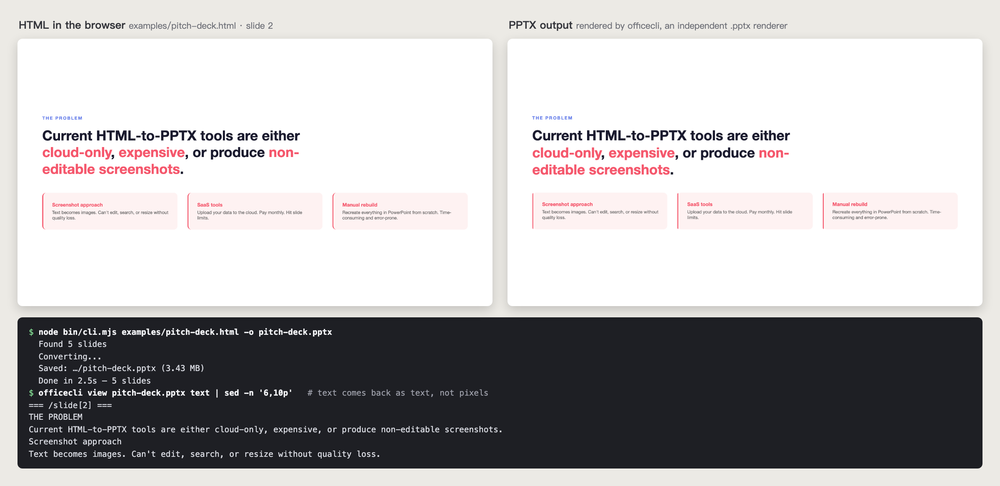

# SlideSmith

**用 HTML 锻造可编辑的 PowerPoint 文件。**

> **状态：** 稳定 · 低频维护 · 2026-10 最后核验。

**适用场景：** AI（或你自己）用 HTML 做好了一套幻灯片，但要交给的人只收 PowerPoint 文件。

一行命令把支持的 HTML + CSS 映射成 PowerPoint 原生对象——文字还是文字，形状还是形状。遇到无法可靠翻译的布局，可改用截图模式保留外观，但截图内容不可编辑。不上传云端，不限页数，不花钱。

```bash
git clone https://github.com/AliceLJY/slidesmith.git && cd slidesmith && npm install
node bin/cli.mjs presentation.html
```

> **本地跑** —— clone 下来直接用，不发 npm。（npm 上的 `slidesmith` 是另一个无关的包，别 `npm i slidesmith`。）



## 为什么做这个？

| | SlideSmith | SaaS 转换工具 | 截图贴 PPT |
|---|---|---|---|
| 文字可编辑 | 是 | 是 | 否（变成图片） |
| 页数限制 | 无限 | 免费版常见限页 | 无限 |
| 费用 | 免费 | 多为付费订阅 | 免费 |
| 数据隐私 | 100% 本地 | 上传云端 | 100% 本地 |
| CSS 支持 | Flexbox、Grid、渐变 | 因平台而异 | 全部（反正是图片） |

## 原理

1. **本地 HTTP 服务器** 托管 HTML 和资源文件（图片、字体）
2. **无头浏览器**（Playwright）渲染 HTML，利用真实的浏览器排版引擎处理 flexbox/grid 布局
3. **[dom-to-pptx](https://github.com/atharva9167j/dom-to-pptx)** 遍历渲染后的 DOM，读取每个元素的最终位置和样式，映射为 PPTX 原生对象（通过 [PptxGenJS](https://github.com/gitbrent/PptxGenJS)）
4. 输出：由原生文本框和形状组成的真正 `.pptx` 文件。可编辑性是解包生成的 XML 核过的；PowerPoint、Keynote、Google Slides 都能导入 `.pptx`，但本仓没有逐个应用系统测试

核心洞察：浏览器的排版引擎已经帮你算好了所有布局，我们只是读取最终结果。

**两种模式。** 默认输出**可编辑**的 PPTX（文字仍是文字）。遇到可编辑路径无法翻译的复杂 CSS，加 `--screenshots` 把每页截成像素级精确（但不可编辑）的 2x 图片；可编辑转换报错时，SlideSmith 会自动尝试截图模式并明确报告最终模式。若浏览器、输入文件或输出路径本身不可用，降级也可能失败。

## 快速开始

### Clone 下来跑

```bash
git clone https://github.com/AliceLJY/slidesmith.git
cd slidesmith
npm install
node bin/cli.mjs my-slides.html
```

> 想要一个短的 `slidesmith` 命令？在仓库里跑一次 `npm link`，它会软链接一个本地 `slidesmith` 命令供你全局调用。不发布到 npm；下文命令默认你已经 `npm link` 过（否则就用 `node bin/cli.mjs`）。

### 首次使用

SlideSmith 会优先使用你系统里已安装的 Chrome。如果没有可用的浏览器：

```bash
npx playwright install chromium
```

## 用法

```bash
# 基本用法 — 在当前目录输出 my-slides.pptx
slidesmith my-slides.html

# 自定义输出路径
slidesmith deck.html -o ~/Desktop/presentation.pptx

# 跳过字体嵌入（更快、文件更小）
slidesmith deck.html --no-fonts

# 截图模式 — 像素级精确、不可编辑（适合复杂 CSS）
slidesmith deck.html --screenshots

# 安静模式
slidesmith deck.html -q
```

## HTML 编写规范

每页 slide 用 `class="slide"` 标记，设定明确的宽高：

```html
<div class="slide" style="width: 1920px; height: 1080px; padding: 80px;
  background: linear-gradient(135deg, #667eea, #764ba2);
  font-family: Arial, sans-serif; color: white;
  display: flex; flex-direction: column; justify-content: center;">

  <h1 style="font-size: 72px;">标题写这里</h1>
  <p style="font-size: 28px; margin-top: 20px;">这段文字在 PowerPoint 里可以直接编辑。</p>
</div>
```

### 支持的 CSS 属性

- **布局**: `display: flex`, `display: grid`, `position: absolute/relative`, `gap`
- **背景**: `background-color`, `linear-gradient()`, `background-image`（URL/base64）
- **边框**: `border`, `border-radius`（含单角设置）
- **阴影**: `box-shadow`（单个和多个）
- **字体**: `font-family`, `font-size`, `font-weight`, `color`, `text-align`, `line-height`, `letter-spacing`
- **变换**: `rotate()`（translate/scale 暂不支持）
- **其他**: `opacity`, `padding`, `filter: blur()`

### 已知限制

- **渐变会变成图片。** 上游库把 `linear-gradient()` 背景导出成位图，文件会变大：自带的 5 页 `pitch-deck.html` 示例生成 3.43 MB，大头是两张渐变背景。
- **输出页面固定 16:9**（13.33 × 7.5 英寸）。幻灯片请按 1920×1080 或 960×540 制作，其他宽高比不会保留。
- 不支持 `translate()` / `scale()` 变换。

### 图片

相对路径、绝对 URL、base64 data URI 都可以用。相对路径相对 HTML 文件所在目录解析（转换时由本地 server 服务），引用的资源放在该目录或其子目录里即可：

```html
<!-- 都可以 -->


<!-- 不行：超出 HTML 文件所在目录 -->

```

### 安全提示

**只转换你信任的 HTML。** SlideSmith 会在真实的 headless 浏览器里渲染 HTML 并执行其中的脚本（可联网）。不要喂不可信的页面。

### 多页

```html
<div class="slide" style="width: 1920px; height: 1080px;">
  <h1>第 1 页</h1>
</div>

<div class="slide" style="width: 1920px; height: 1080px;">
  <h1>第 2 页</h1>
</div>
```

## 示例模板

`examples/` 目录包含几个现成的模板：

- **`minimal.html`** — 单页最简示例
- **`pitch-deck.html`** — 5 页路演 deck，含渐变、卡片和表格
- **`data-dashboard.html`** — KPI 卡片和 CSS 柱状图

试试看：

```bash
node bin/cli.mjs examples/pitch-deck.html -o pitch-deck.pptx
```

## 编程接口

```javascript
import { convert } from './lib/converter.mjs';

const result = await convert('slides.html', 'output.pptx', {
  quiet: false,
  autoEmbedFonts: true,
  mode: 'editable',   // 或 'screenshots'（像素级精确、不可编辑）
  fallback: true,     // 可编辑转换失败时自动降级截图
});

console.log(`${result.slideCount} 页, ${result.fileSize} 字节`);
```

## 背景

这个工具为什么做、怎么做出来的：[docs/story.md](docs/story.md)。

## 致谢

SlideSmith 是一层薄薄的 CLI 封装，真正干活的是：

- **[dom-to-pptx](https://github.com/atharva9167j/dom-to-pptx)** — DOM 遍历和 PPTX 元素映射
- **[PptxGenJS](https://github.com/gitbrent/PptxGenJS)** — PowerPoint 文件生成
- **[Playwright](https://playwright.dev/)** — 无头浏览器渲染

## 许可证

[MIT](LICENSE)
